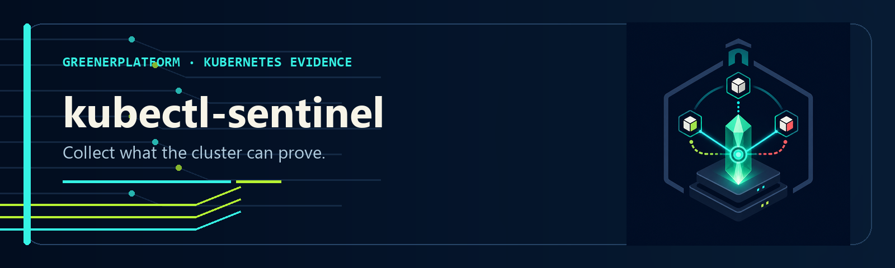

<div align="center">
  
</div>

<div align="center">
  
  
  
  
  
  
</div>

<p align="center"><em>A point-in-time Kubernetes evidence collector with stable checks, provenance, and explicit collection status.</em></p>

---

## What it does

kubectl-sentinel applies rule-based checks to a series of Kubernetes API reads and emits
severity-ranked observations. Each actionable finding includes a recommended next step.
That step may gather evidence, validate a hypothesis, or propose remediation; it is not
an automatically safe fix.

> **One command. 15 health dimensions. Text, JSON, or HTML output.**

```bash
kubectl sentinel -n payments
```

```
══ SENTINEL REPORT ══
Context : prod-cluster
Scope   : namespace: payments

CRITICAL  payments/api-gateway: CrashLoopBackOff (restarts: 47)
          → kubectl logs api-gateway -n payments --previous
CRITICAL  payments: Deployment api-gateway — 0/3 replicas available
          → kubectl describe deploy/api-gateway -n payments
WARN      FailedMount: Secret api-keys not found in namespace payments
WARN      payments/api-gateway: Liveness probe failing

Summary: 2 CRITICAL · 2 WARN · 8 OK
```

---

## Install

```bash
# Source install
git clone https://github.com/GreenerPlatform/kubectl-sentinel
cd kubectl-sentinel
mkdir -p "$HOME/.local/bin"
bash install.sh "$HOME/.local/bin"
export PATH="$HOME/.local/bin:$PATH"
```

**Requirements:** Linux · Bash · `kubectl` · `jq` · standard Unix utilities · a valid
kubeconfig. `kubectl` contacts the selected Kubernetes API and may invoke a networked
credential plugin. The CLI makes no direct SaaS or LLM calls.

Krew and Homebrew metadata exists in the repository, but neither package is currently
published. The source install above is the supported public path.

---

## Usage

```bash
kubectl sentinel                          # full cluster check (all namespaces)
kubectl sentinel -n <namespace>           # scoped to one namespace
kubectl sentinel --context <name>         # target a specific kubeconfig context
kubectl sentinel --context <name> -n <ns> # context + namespace scope
kubectl sentinel pod/<name>               # pod deep-dive
kubectl sentinel pod/<name> -n <ns>       # pod deep-dive in specific namespace
kubectl sentinel node/<name>              # node deep-dive
kubectl sentinel --json                   # JSON output (schema v1.2)
kubectl sentinel --json -n <namespace>    # JSON output (scoped)
kubectl sentinel --no-color               # plain text (no ANSI)
kubectl sentinel --verbose                # full per-pod/per-node detail
```

## What it checks

| Section | What | CRITICAL when | WARN when |
|---------|------|---------------|-----------|
| NODES | Ready state, pressure conditions, version skew, cordoned nodes | NotReady, MemoryPressure, DiskPressure, PIDPressure | Version skew, kubelet warnings |
| PODS | Phase, restart count, container state | CrashLoopBackOff, OOMKilled | Image pull errors, Pending with reason, high restart count |
| PROBES | Liveness, readiness, startup probe health | Liveness failing | Readiness/startup failing, missing probes |
| WORKLOADS | Deployments, StatefulSets, DaemonSets — replica availability | 0 available replicas | Partial replica availability |
| HTTP | Candidate Services and ready/not-ready endpoint addresses | Empty endpoints | Not-ready endpoints |
| gRPC | Services with `grpc` port name or `appProtocol`; endpoint address counts | Empty endpoints | Not-ready endpoints |
| EVENTS | Warning events grouped by reason; selected threshold-based findings | — | Threshold exceeded |
| RESOURCES | Node CPU/memory via `kubectl top` | ≥95% | ≥85% |
| PVCS | PersistentVolumeClaim state | Pending, Lost | — |
| HPAS | HPA autoscaling constraints | minReplicas == maxReplicas | At maxReplicas ceiling |
| JOBS | Jobs & CronJobs — completion, backoff, scheduling | Job `Failed` condition | Retrying (no success yet), suspended CronJob |
| PDBS | PodDisruptionBudgets — protection & drain safety | `currentHealthy < desiredHealthy` | `disruptionsAllowed == 0` (blocks drains) |
| QUOTAS | ResourceQuota saturation (integer resources) | ≥100% (objects rejected) | ≥90% |
| DNS | CoreDNS/kube-dns availability (kube-system, cluster-wide) | 0 replicas available | Degraded (partial) |
| CERTS | cert-manager Certificate expiry & readiness | Expired / ≤7d / not Ready | ≤21d to expiry |

PODS also flags missing CPU requests and memory limits (WARN). WORKLOADS flags stuck
rollouts (`Progressing=False` / `ProgressDeadlineExceeded`, WARN).

HTTP and gRPC checks count Kubernetes endpoint addresses; they do not send protocol
requests or prove application availability. ExternalName, selectorless, multi-port, and
partially collected endpoint data may require manual validation.

## Flags

| Flag | Description |
|------|-------------|
| `-n <namespace>` | Scope namespaced collectors; NODES, node RESOURCES, and DNS remain cluster-wide |
| `--context <name>` | Use a specific kubeconfig context without changing the active one |
| `--json` | Emit findings as structured JSON (schema v1.2) to stdout |
| `--no-color` | Disable ANSI colour output |
| `--verbose` | Expand all grouped findings; remove WARN recommendation cap |
| `-h`, `--help` | Show usage |

## Exit codes

| Code | Meaning |
|------|---------|
| `0` | No WARN or CRITICAL findings were emitted |
| `1` | One or more WARN findings |
| `2` | One or more CRITICAL findings |

Exit codes are preserved in `--json` mode. Inspect coverage before treating exit code `0`
as healthy. Handle the expected non-zero finding codes explicitly in CI:

```bash
status=0
kubectl sentinel --json -n payments > snap.json || status=$?
case "$status" in 0|1|2) ;; *) exit "$status" ;; esac
jq -e '.schema_version == "1.2"' snap.json >/dev/null
```

## JSON output

Emits a single JSON object to stdout. Errors go to stderr. Safe for pipes and redirection.

```json
{
  "schema_version": "1.2",
  "tool_version": "1.3.2",
  "generated_at": "<ISO8601>",
  "context": "<context name>",
  "scope": "all namespaces | namespace: <name>",
  "exit_code": 0,
  "summary": { "critical": 0, "warn": 3, "ok": 8 },
  "sections": [
    {
      "section": "PODS",
      "findings": [
        {
          "id": "POD-CRASHLOOP",
          "check_id": "POD-CRASHLOOP",
          "severity": "CRITICAL",
          "message": "<finding>",
          "recommendation": "kubectl logs ... --previous",
          "collection_status": "complete",
          "subjects": [
            { "kind": "Pod", "namespace": "payments", "name": "api-gateway", "uid": "..." }
          ],
          "last_event": { "timestamp": "...", "reason": "...", "message": "..." }
        }
      ]
    }
  ]
}
```

Each finding carries a stable `id`/`check_id` (for example `POD-CRASHLOOP`) — a durable
handle for a finding *type* that stays constant across runs even if the message is reworded.
Use it to reference, group, suppress, or correlate finding types without parsing message
text.

Schema 1.2 also reports `collection_status` (`complete`, `partial`, `failed`, or
`not_available`) and collector coverage. Collection-status propagation currently covers
the primary instrumented paths; some secondary and optional collector failures remain a
known gap. Do not interpret `complete`, an `OK` finding, or exit code `0` as proof that
every possible source was collected.

`--json` is not supported for `pod/<name>` or `node/<name>` deep-dive modes.

## Works with incident-triage

Pipe the JSON output directly into [incident-triage](https://github.com/GreenerPlatform/incident-triage)
to rank the observations against an alert and produce an incident hypothesis:

```bash
kubectl sentinel --json -n payments > snap.json
incident-triage --sentinel-json snap.json --alert "payments API 503 since 14:30"
```

kubectl-sentinel performs multiple sequential API reads. incident-triage classifies
the alert, scores each sentinel finding by relevance, and emits compatibility fields such
as `root_cause`, `causation_chain`, and a P1 command. Their values are candidate hypotheses
and response steps, not proof of causation or command safety.

## Using it from an AI agent (any runtime)

Two paths, both vendor-neutral:

**1. MCP server.** The
[GreenerPlatform MCP server](https://github.com/GreenerPlatform/greenerplatform-mcp)
exposes `sentinel_snapshot` and `triage_incident` to compatible MCP hosts. Client
configuration and operating-system support vary; follow the MCP repository's tested setup.

**2. Reference agent skill.** [`skills/SKILL.md`](skills/SKILL.md) is a reference reasoning-layer
integration (a Claude Code command). Copy it into your agent's command directory:

```bash
cp skills/SKILL.md /path/to/your-project/.claude/commands/sentinel.md
```

```
/sentinel -n payments
/sentinel pod/api-gateway-abc123 -n payments
/sentinel node/worker-1
```

The reasoning layer reads the JSON and explains *why* findings matter — correlating a
FailedMount to every deployment blocked by the same missing secret, and distinguishing an
OOMKill that needs a higher limit from one that signals a memory leak.

## Why the dual-layer pattern

kubectl-sentinel is the rule-based collection layer: it reads cluster state, applies
severity rules, and emits structured output. Equivalent captured inputs and tool versions
produce reproducible classifications, but a live report is a mixed-time observation
because collection spans multiple API reads.

The reasoning layer reads that JSON and may explain why observations matter. The schema
makes evidence and gaps visible; it cannot guarantee that a host model uses them correctly.

Separating them means each layer is independently testable, portable, and composable.

---

## Security and data handling

Reports can contain cluster context, node, namespace, workload, image, Secret, and event
details. Pod deep-dive mode can include application logs. Treat reports as sensitive.
Remove credentials, tokens, customer data, internal hostnames, and identifying metadata
before sharing output in public issues or with third-party services.

Review every mutating recommendation against workload ownership, rollout policy, current
evidence, and rollback options before execution.

---

## Contributing

Issues and pull requests welcome. See [CONTRIBUTING.md](CONTRIBUTING.md).

Design rule: every actionable finding names the observation and a reviewable next step.
